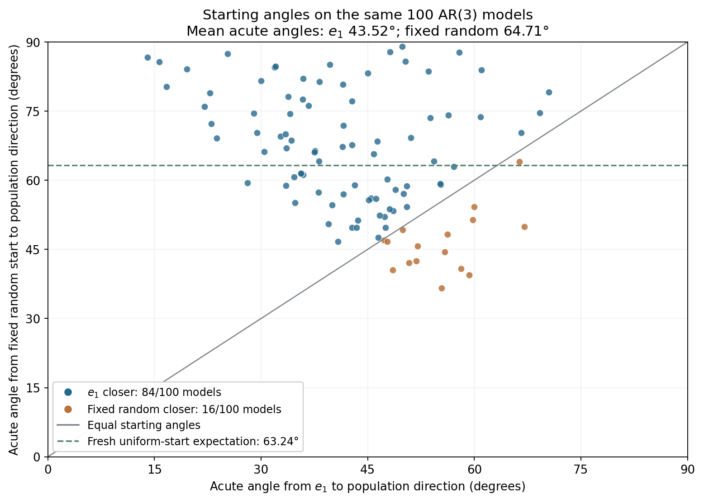

# Angle analysis of the e1 versus fixed-random initialization comparison

The calculations below use the 100 exact Experiment 3 coefficient vectors and the returned directions at the matched normalized setting gamma0=0.2/L, H=50, cap 2000, patience 200, with no restarts. No new optimization runs are needed. [Matched design and results](findings.md), [population direction and coefficient recovery in the thesis](../../../Abschlussarbeit_2021/LaTeX/chapters/3_application_to_time_series.tex).

## Define one common target and account for sign

The width objective has w(u)=w(-u), directly from the max-minus-min formula. Therefore use the acute, sign-adjusted angle alpha(u,v)=arccos(|u dot v|), between 0 and pi/2, for unit vectors. This is our chosen measure of distance to the target line {+v,-v}. Comparing each initialization with its own fitted result uses different targets; the fitted result also depends on the initialization. The theoretical uniform-start calculation below assumes a fixed target independent of the random draw.

## Direct derivation for the population direction

Taking the population minimizing direction stated in Proposition `prop:minimum_width`, u_phi=(1,-phi)/sqrt(1+||phi||^2), gives

    alpha(e1,u_phi) = arccos(1/sqrt(1+||phi||^2)) = arctan(||phi||).

This is a direct calculation from the thesis's formula, not an additional theorem about convergence of the empirical optimizer.

## Expected acute angle for a fresh uniform random start

Cai, Fan and Jiang (2013), Lemma 12(i), equation (13), p. 1851 (PDF page 15), gives the ordinary-angle density proportional to sin(theta)^(d-2). For d=4 this is 2/pi sin(theta)^2 on [0,pi]. Rotation invariance gives the same distribution for a uniform random direction and a fixed unit target. Folding theta and pi-theta together gives the acute-angle density

    f_alpha(t) = 4/pi sin(t)^2, 0 <= t <= pi/2.

Our direct integration then gives

    E[alpha] = (4/pi) integral_0^(pi/2) t sin(t)^2 dt
             = pi/4 + 1/pi radians = 63.2378130556 degrees.

Source: [Cai, Fan and Jiang, Lemma 12 and equation (13)](https://jmlr.org/papers/volume14/cai13a/cai13a.pdf#page=15). The unfurled ordinary angle has mean 90 degrees, but it distinguishes u and -u even though they give the same width.

It follows that e1 has smaller angle than the expected fresh-random angle precisely when ||phi|| < tan(pi/4+1/pi), approximately 1.982914. This condition is not automatic for every causal AR(3) model.

## Results on the 100 models

| Reference | Mean acute angle from e1 | Mean acute angle from the actual fixed random start |
| --- | --- | --- |
| Known population direction u_phi | 43.52291163 degrees | 64.71064305 degrees |
| Common fitted direction returned by the e1 run | 43.70506814 degrees | 64.18654810 degrees |

- e1 is closer to the population target than the actual fixed random start on **84/100** models.
- Its angle is below the theoretical uniform-start mean on **95/100** models.
- Population-target angles from e1 range from 14.04638466 to 70.45683453 degrees. Actual fixed-random angles range from 36.64266542 to 89.04702329 degrees.
- At the matched normalized setting, the mean final angle to the population direction is 2.46932078 degrees for the e1 runs versus 25.37615679 degrees for the fixed-random runs. The population direction is a known reference, not a certified empirical minimizer.
- Among the 16 models where the random start is initially closer to the population target, e1 still gives lower coefficient MAE on 9, random on 6, and 1 tie within 1e-12. Starting angle alone therefore does not determine the outcome.

## Additional coefficient-recovery conditioning

The actual fixed random start has first coordinate 0.04690430049805569. Applying the coefficient map to that start gives [ 17.30249735  -6.66938892 -10.4730856 ], with Euclidean norm 21.29654162; e1 corresponds to the zero vector. For the map phi(u)=-u_tail/u_first, direct differentiation gives

    delta phi = -delta u_tail/u_first + u_tail delta u_first/u_first^2.

Thus recovery is sensitive near u_first=0. This is a conditioning observation, not a proof of the cause of the optimization failures. With stationarity restarts disabled, the width optimizer itself does not use these coefficient ratios in its updates. A bad initial coefficient vector does not by itself establish that the width descent will fail. Sources: [coefficient transformation](../../../Code/Code_AR_processes/ar_tools/functions.py), [descent update](../../../Code/Code_AR_processes/ar_tools/descent.py).

## Interpretation and limits

The observed angular advantage supports the hypothesis that e1 starts in a more favorable region for these AR models. Li et al.'s local linear convergence result requires sufficiently close initialization and suitable geometric step sizes; it supports the relevance of initialization, but it does not certify that these specific starts and schedules satisfy its neighborhood assumptions. See [Li et al., section 5.2, Theorem 4](https://arxiv.org/html/1911.05047v4).

This is evidence for a partial explanation, not proof that initial angle causes the full difference in coefficient error. The empirical landscape, trajectory and finite stopping rule still matter. It compares one fixed random direction over 100 models, not independently redrawn starts on each model.

## Per-model angle and error diagnostics

| Model | Coefficient norm | e1 angle to population (degrees) | Fixed random angle (degrees) | e1 coefficient MAE | Random coefficient MAE |
| --- | --- | --- | --- | --- | --- |
| 1 | 1.73264752 | 60.008545 | 54.2499415 | 0.0105888176 | 0.0109831544 |
| 2 | 1.13492716 | 48.6162772 | 53.3532075 | 0.00189610057 | 0.00196609222 |
| 3 | 1.21202356 | 50.4751026 | 58.7535463 | 0.135428295 | 0.135428295 |
| 4 | 1.71827383 | 59.8014758 | 51.3626187 | 0.0529642119 | 0.0525338965 |
| 5 | 2.81716604 | 70.4568345 | 79.1453949 | 0.00838899083 | 0.00838899083 |
| 6 | 0.92501824 | 42.7693886 | 49.7512575 | 0.014086577 | 0.047560235 |
| 7 | 0.404682238 | 22.0323048 | 76.0130511 | 0.00318083567 | 11.3376616 |
| 8 | 0.745610158 | 36.7085857 | 76.1760263 | 0.00393683779 | 4.03973677 |
| 9 | 1.08696623 | 47.3861991 | 52.0500921 | 0.0166972953 | 0.0166972953 |
| 10 | 1.14657383 | 48.9062464 | 57.9192338 | 0.0046433715 | 0.0046433715 |
| 11 | 0.588443768 | 30.4744182 | 66.1844553 | 0.0328220659 | 4.93142734 |
| 12 | 0.785838695 | 38.1616336 | 64.1084168 | 0.0132640402 | 0.0132640402 |
| 13 | 0.421072828 | 22.8346371 | 78.9415308 | 0.0039529877 | 9.28175666 |
| 14 | 0.88268644 | 41.4344075 | 67.2799698 | 0.0660498238 | 0.0834698733 |
| 15 | 1.09028433 | 47.4732032 | 49.7679003 | 0.00395489015 | 0.00395489015 |
| 16 | 1.22601851 | 50.797651 | 42.1113989 | 0.0315634042 | 0.0315634042 |
| 17 | 1.00046175 | 45.0132252 | 83.25957 | 0.0177574229 | 13.148382 |
| 18 | 0.553410045 | 28.9605825 | 74.4963205 | 0.00597312126 | 1.23796235 |
| 19 | 1.35272409 | 53.5263707 | 83.6163402 | 0.0012529399 | 0.742560717 |
| 20 | 0.723980665 | 35.9038116 | 61.1831361 | 0.00477333611 | 0.0045311207 |
| 21 | 0.724915078 | 35.9389224 | 82.0986906 | 0.00223425527 | 48.1490901 |
| 22 | 1.27976615 | 51.9961887 | 45.7029004 | 0.00647431237 | 0.00338817205 |
| 23 | 1.792346 | 60.8416291 | 73.7474222 | 0.441841808 | 0.607350365 |
| 24 | 0.824266572 | 39.4976183 | 50.5107718 | 0.0071824147 | 0.0071824147 |
| 25 | 0.86399465 | 40.82684 | 46.6517963 | 0.0392083818 | 0.0532293245 |
| 26 | 1.01571422 | 45.4466608 | 56.0703435 | 0.00336867012 | 0.252862285 |
| 27 | 0.768756552 | 37.5515181 | 66.3544942 | 0.0948748232 | 0.0528488662 |
| 28 | 1.60980537 | 58.1517348 | 40.8459786 | 0.0608139315 | 0.0878485972 |
| 29 | 1.39228701 | 54.3124779 | 64.1749328 | 0.0234267087 | 0.0234267087 |
| 30 | 0.722219947 | 35.8375673 | 77.5993054 | 0.00592449526 | 7.2827467 |
| 31 | 0.680821139 | 34.2478615 | 68.66692 | 0.00232040925 | 0.00232040925 |
| 32 | 2.63060803 | 69.1861874 | 74.650113 | 0.00179307246 | 0.00179307246 |
| 33 | 1.27348865 | 51.8594186 | 42.5287388 | 0.101484421 | 0.169518677 |
| 34 | 1.05391056 | 46.503541 | 47.5473707 | 0.0372050394 | 0.512947139 |
| 35 | 0.926121687 | 42.8034401 | 77.1290458 | 0.00755341875 | 77.278291 |
| 36 | 0.716917932 | 35.6374175 | 61.5063691 | 0.0357320392 | 0.02299452 |
| 37 | 0.299954075 | 16.6968301 | 80.3215103 | 0.00134517708 | 2.04456695 |
| 38 | 0.622067426 | 31.8843976 | 84.5209094 | 0.00208912608 | 9.80210399 |
| 39 | 1.68410847 | 59.2987532 | 39.4755791 | 0.387612003 | 0.0374837479 |
| 40 | 0.664250282 | 33.5941115 | 67.0168242 | 0.00495796125 | 35.2891224 |
| 41 | 1.50415013 | 56.3829571 | 74.144483 | 0.00427297422 | 0.00427297422 |
| 42 | 0.534453237 | 28.1224197 | 59.3832958 | 0.0056663893 | 5.01656867 |
| 43 | 1.10037905 | 47.7361363 | 60.2136012 | 0.00107264798 | 0.00137349019 |
| 44 | 0.577643388 | 30.0125943 | 81.575069 | 0.00400305141 | 3.33685865 |
| 45 | 0.716634881 | 35.6267041 | 61.4928929 | 0.0051215562 | 0.0051215562 |
| 46 | 1.44197563 | 55.2589627 | 59.0353946 | 0.367302503 | 0.674680185 |
| 47 | 0.952143992 | 43.5956988 | 51.3039384 | 0.0102977527 | 0.0102977527 |
| 48 | 1.18507155 | 49.8412927 | 89.0470233 | 0.0803412674 | 0.0803412674 |
| 49 | 0.662655579 | 33.5306678 | 58.8802111 | 0.0223124764 | 12.2067057 |
| 50 | 0.642252177 | 32.7106934 | 69.4738779 | 0.0102010534 | 0.0102010534 |
| 51 | 2.36089384 | 67.0440199 | 49.9362168 | 0.254990928 | 0.00360570466 |
| 52 | 2.28299326 | 66.3455505 | 64.0177695 | 0.783999748 | 0.982746426 |
| 53 | 0.93777675 | 43.1608278 | 58.9526247 | 0.0125462512 | 0.0125462512 |
| 54 | 1.06063833 | 46.6855545 | 52.3546005 | 0.0411910325 | 0.0412938607 |
| 55 | 0.355850292 | 19.5881163 | 84.1374734 | 0.0058639805 | 215.367333 |
| 56 | 0.695104711 | 34.8033458 | 55.0795832 | 0.0172808996 | 0.0172808996 |
| 57 | 0.47225093 | 25.2790671 | 87.4931793 | 0.0074459725 | 127.754814 |
| 58 | 0.926482102 | 42.8145542 | 67.6814648 | 0.00748301403 | 0.0718191511 |
| 59 | 1.08311688 | 47.2849037 | 46.9900081 | 0.00224278615 | 0.143073251 |
| 60 | 0.676829385 | 34.0912965 | 74.432252 | 0.0119054613 | 0.0119054613 |
| 61 | 0.66990807 | 33.8184498 | 78.1535012 | 0.00275128455 | 7.0663554 |
| 62 | 0.838654351 | 39.9850253 | 54.6159744 | 0.0230131087 | 0.0230142662 |
| 63 | 1.18728945 | 49.8940866 | 49.2730968 | 0.313032805 | 0.116458635 |
| 64 | 2.30791029 | 66.5732816 | 70.257605 | 0.0109534522 | 0.535691157 |
| 65 | 0.660984392 | 33.4640812 | 69.9965499 | 0.00522733286 | 0.00522733286 |
| 66 | 1.1318371 | 48.5387798 | 40.5332281 | 0.0090843797 | 0.0553670659 |
| 67 | 1.0419038 | 46.1756548 | 55.9644668 | 0.00244744968 | 0.00244744968 |
| 68 | 1.10060783 | 47.7420646 | 46.69403 | 0.00901323135 | 0.00718056509 |
| 69 | 0.947531652 | 43.4567707 | 49.7701768 | 0.00378383736 | 0.00378383736 |
| 70 | 0.768520463 | 37.5430149 | 66.0620703 | 0.04894552 | 0.0357744057 |
| 71 | 0.887024487 | 41.5738109 | 71.8356795 | 0.0170112829 | 3.87587711 |
| 72 | 0.783197205 | 38.0679479 | 57.3549967 | 0.0192073857 | 0.0192073857 |
| 73 | 1.49682588 | 56.2538923 | 48.3046586 | 0.239650074 | 0.469918626 |
| 74 | 1.47225843 | 55.8145325 | 44.4405088 | 0.254756322 | 0.304238464 |
| 75 | 1.04800927 | 46.3428771 | 68.4533655 | 0.0212915196 | 0.0212915196 |
| 76 | 0.691868125 | 34.6781247 | 60.7131022 | 0.0277621683 | 2.22637591 |
| 77 | 0.885085816 | 41.5115858 | 80.8056381 | 0.0222112449 | 0.0211707878 |
| 78 | 0.250188068 | 14.0463847 | 86.6197764 | 0.0143544404 | 51.3114452 |
| 79 | 0.564268523 | 29.4346693 | 70.3074401 | 0.00846267955 | 2.38084191 |
| 80 | 1.23687242 | 51.0447787 | 69.1811638 | 0.0158619138 | 0.0158619138 |
| 81 | 0.625922344 | 32.0433694 | 84.7448224 | 0.00461686207 | 3.44187118 |
| 82 | 1.00597568 | 45.1706802 | 55.7471018 | 0.040667287 | 0.0406672845 |
| 83 | 1.20455844 | 50.3012301 | 85.7812611 | 0.0170018729 | 0.0169167452 |
| 84 | 1.54714787 | 57.1233678 | 62.9898687 | 0.0631724817 | 0.0349683113 |
| 85 | 0.787076272 | 38.2054441 | 81.3915618 | 0.0236975558 | 2.95922305 |
| 86 | 0.440780859 | 23.7869669 | 69.0935929 | 0.00420947207 | 1.53391935 |
| 87 | 1.21285638 | 50.4944213 | 54.1918782 | 0.0458547686 | 0.0458547686 |
| 88 | 1.36796471 | 53.8327104 | 73.5630432 | 0.00976117468 | 0.962713066 |
| 89 | 1.11647845 | 48.1500429 | 87.8504632 | 0.00553299121 | 0.00620132092 |
| 90 | 1.44059221 | 55.2332052 | 59.1986307 | 0.00853707375 | 0.00884067527 |
| 91 | 1.03063628 | 45.8643579 | 65.6723131 | 0.00888929582 | 0.0102938746 |
| 92 | 1.59174551 | 57.861272 | 87.7202844 | 0.00237217098 | 0.835786305 |
| 93 | 1.44837026 | 55.3775909 | 36.6426654 | 0.0126587748 | 0.0127187049 |
| 94 | 1.80541026 | 61.0183379 | 83.9498338 | 0.00833608919 | 0.00833608919 |
| 95 | 0.829752587 | 39.6842787 | 85.0872011 | 0.00320145382 | 70.9896476 |
| 96 | 0.281292491 | 15.7108939 | 85.6721793 | 0.00488028162 | 8.71609731 |
| 97 | 0.423909889 | 22.9725681 | 72.2581051 | 0.00841025259 | 4.98868532 |
| 98 | 0.888364659 | 41.6167562 | 56.9449115 | 0.0135990239 | 2.88539147 |
| 99 | 1.11314445 | 48.0648709 | 53.7245814 | 0.0107459585 | 0.0108432968 |
| 100 | 1.19385121 | 50.049606 | 57.0345925 | 0.000814154089 | 0.000814154089 |
