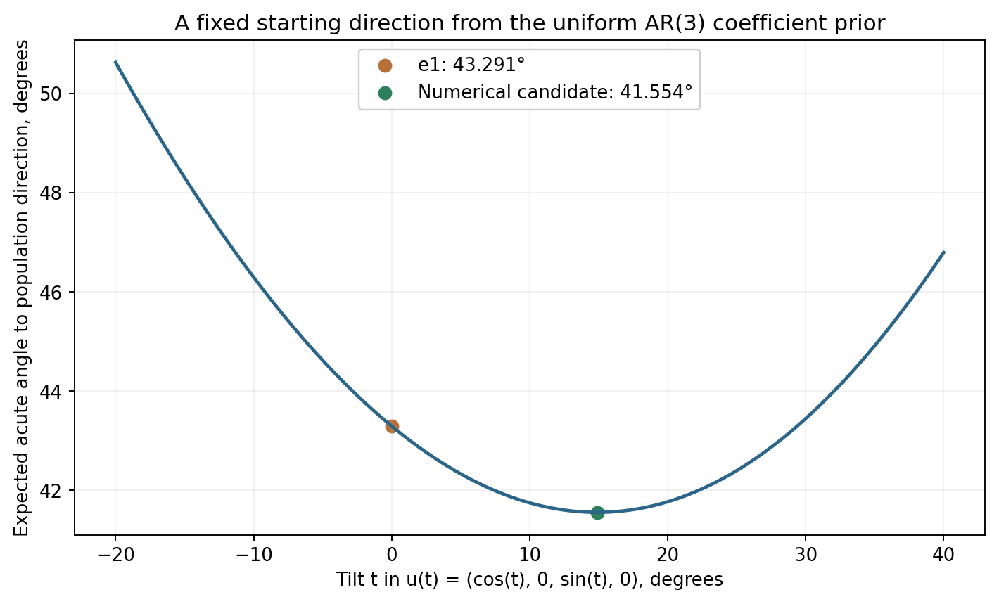

# A fixed starting direction chosen from the uniform causal AR(3) prior

This is a new numerical calculation over the coefficient prior, independent of the 100 models used in Experiments 3 and 4. No time-series fitting or thesis editing is performed.

## Objective

Let Phi be uniform with respect to coefficient-space Lebesgue volume on the causal region C3, and let v(Phi)=(1,-Phi)/sqrt(1+||Phi||^2). Minimize R(u)=E[arccos(|u dot v(Phi)|)] over ||u||=1. Opposite directions are identified. This defines the best fixed direction for expected acute angle, not necessarily the best optimizer initialization for final coefficient error.

The expected-distance minimizer is a Frechet median on the space of unoriented directions; squared distance defines a different objective. See [Yang, introduction and section 2](https://arxiv.org/pdf/1110.3899). The population direction is the one stated in [the thesis proposition](../../../Abschlussarbeit_2021/LaTeX/chapters/3_application_to_time_series.tex).

## Uniform-prior integration and coefficient asymmetry

The Jones sampler uses independent a=2 Beta(1,1)-1, b=2 Beta(1,2)-1, c=2 Beta(2,2)-1 for AR(3). Its recursion gives phi1=a(1-b)-cb, phi2=b-ca(1-b), phi3=c. The joint density of (a,b,c) is 3/16 (1-b)(1-c^2). The Jacobian determinant is (1-b)(1-c^2), so the induced coefficient density is constant, 3/16, on C3. The transformation onto the causal region is the Jones parametrization.

My direct calculation from independence gives E[Phi]=(0,-1/3,0). Therefore the coefficient prior is not centered at zero. The third direction coordinate corresponds to the negative of the second AR coefficient. Sources: [Jones (1987), pp. 134-138](https://doi.org/10.2307/2347544), [implemented sampler](../../../Code/Code_AR_processes/ar_tools/functions.py).

## Numerical candidate

Best direction found: [0.9664275659631906, 0.0, 0.2569392141080513, 0.0]. It corresponds to initial coefficients [-0.0, -0.26586494752141376, -0.0]. Its tilt from e1 is 14.88852314 degrees.

Expected acute angle: candidate 41.55412217 degrees; e1 43.29111066 degrees. Improvement: 1.73698848 degrees.

| Quadrature nodes per PACF | Direction first component | Direction third component | Candidate expected angle (degrees) | e1 expected angle (degrees) |
| --- | --- | --- | --- | --- |
| 20 | 0.9664385263 | 0.2568979854 | 41.5545661358 | 43.2914796360 |
| 40 | 0.9664276204 | 0.2569390094 | 41.5541484406 | 43.2911341529 |
| 64 | 0.9664277111 | 0.2569386682 | 41.5541254776 | 43.2911136723 |
| 96 | 0.9664275660 | 0.2569392141 | 41.5541221716 | 43.2911106564 |

The initial full-sphere search used 48 starts at 20^3 quadrature nodes, including all coordinate axes and 43 Gaussian starts. The best value matched the (first, third)-coordinate-plane solution. Three full-sphere refinements at 40^3 nodes agreed with that candidate. Some starts reached other stationary or poorly converged points. This is numerical evidence; no proof of global optimality or uniqueness is claimed.

Independent validation used 8 scrambled Sobol replicates of 2^17 prior draws each. Mean expected-angle estimates: candidate 41.55411850, e1 43.29110419 degrees. Replicate ranges: candidate [41.55409812, 41.55414086], e1 [43.29107839, 43.29111532].

## Different distances give different centers

For squared Euclidean distance to the canonically oriented v(Phi), expansion gives E||u-v||^2=2-2 u dot E[v], hence u=E[v]/||E[v]||. Numerical direction: [0.969466780932936, 4.9788014255273826e-17, 0.2452226756797393, 5.2850000635647554e-18]. This objective distinguishes v and -v and is not the acute-angle objective.

For squared projector distance, ||uu^T-vv^T||_F^2=2(1-(u dot v)^2), so the optimum is a leading eigenvector of E[vv^T]. Numerical direction: [0.9683707026485084, 2.854524579290331e-15, 0.2495158957902957, 3.657696689950499e-17]. See [Mardia and Patrangenaru, section 4, equations (4.3)-(4.4), reprint pp. 18-19](https://arxiv.org/pdf/math/0508280#page=18). This is a different, sign-invariant squared-sine criterion.

For squared Euclidean coefficient loss, the best fixed coefficient vector is E[Phi]=(0,-1/3,0), whose induced direction is [0.9486832980505138, 0.0, 0.3162277660168379, 0.0]. Averaging coefficients and averaging normalized directions do not commute.

## What this does and does not establish

This construction is a principled fixed initialization for the specified order, prior and distance. It is independent of the time-series observations and the earlier 100 coefficient draws. It does not guarantee a smaller empirical width, faster convergence or lower final coefficient error. Before selecting it as an algorithm default, freeze the prior-derived vector and compare it with e1 and random starts on independent time-series experiments with matched step schedules and stopping rules.

Checks: quadrature weights sum to one, analytic coefficient mean reproduced, objective-gradient finite-difference error 2.9011e-08, quadrature convergence checked, independent randomized-Sobol agreement checked. The global optimum is not certified.

Reproduce with `python3 compute_prior_start.py`. This script writes only this report and the PNG/PDF plot in its own directory.
