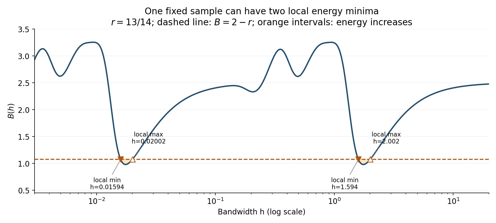

# Gaussian KDE scale energy: extrema, derivatives, minimization and precedents

Research and verification date: 29 October 2026.

The calculations below concern a fixed, finite sample on the real line, equal
weights, and the standard normal kernel. Unless specified otherwise,
\(-1/2<r<2\); this contains the thesis choices \(r=0,1,13/14\).
The mathematical deductions below are direct derivations for this project,
not theorems attributed to the cited papers and not claims of novelty.
No files under `Abschlussarbeit_2021/` were edited.

## 1. Definition and useful representations

Use the functional defined in
[the thesis, Proposition `prop:main_thm`](/Users/iljasukhanov/MASTERARBEIT/Abschlussarbeit_2021/LaTeX/chapters/5_bandwidth_selection.tex:800):

\[
\widehat Q_r(h)=\frac12h^{2(1-r)}\|\partial_h\widehat f_h\|_2^2,
\qquad \widehat f_h=\frac1n\sum_i K_h(\cdot-X_i),\qquad h>0.
\]

The Gaussian heat equation, with heat time \(t=h^2\), implies
\(\partial_h\widehat f_h=h\partial_x^2\widehat f_h\).
See [Botev, Grotowski and Kroese (2010), Section 2, Eq. (2)](https://arxiv.org/pdf/1011.2602#page=4).
Thus, defining \(R_j(h)=\|\partial_x^j\widehat f_h\|_2^2\),

\[
\boxed{\widehat Q_r(h)=\frac12h^{4-2r}R_2(h).}
\]

The squared derivative norm is a familiar KDE functional; its Gaussian
ordered-pair representation appears in
[Botev et al., Section 5, Eq. (26)](https://arxiv.org/pdf/1011.2602#page=15).
In our parametrization, direct integration gives

\[
\widehat Q_r(h)=\frac{h^{-1-2r}}{4\sqrt\pi n^2}
\sum_{i,j}e^{-u_{ij}}p(u_{ij}),\quad
u_{ij}=\frac{(X_i-X_j)^2}{4h^2},\quad
p(u)=u^2-3u+\frac34.
\]

With \(P_n(\omega)=n^{-1}\sum_i e^{-i\omega X_i}\), Parseval gives

\[
\widehat Q_r(h)=\frac{h^{4-2r}}{4\pi}
\int_{\mathbb R}\omega^4e^{-h^2\omega^2}|P_n(\omega)|^2\,d\omega.
\]

This follows from the normalized derivative spectral-energy identity in
[Lindeberg (1998), Section 9.2, Eqs. (82)–(83), author manuscript](https://people.kth.se/~tony/papers/cvap198.pdf#page=41)
by substituting \(m=2,D=1,t=h^2,\gamma=1-r/2\) and the empirical measure.

## 2. Derivatives and exact stationary-point tests

Differentiation and integration by parts are justified by the Gaussian tails:

\[
R_j'(h)=2h\langle\partial_x^j\widehat f_h,
\partial_x^{j+2}\widehat f_h\rangle=-2hR_{j+1}(h).
\]

Consequently,

\[
\boxed{\widehat Q_r'(h)
=h^{3-2r}\big[(2-r)R_2(h)-h^2R_3(h)\big].}
\]

An entirely explicit version, requiring only pairwise differences, is

\[
\boxed{\widehat Q_r'(h)=\frac{h^{-2-2r}}{4\sqrt\pi n^2}
\sum_{i,j}e^{-u_{ij}}P_r(u_{ij}),}
\]

\[
P_r(u)=2u^3-(11+2r)u^2+
\left(\frac{21}{2}+6r\right)u-\frac34(1+2r).
\]

Indeed, \(du_{ij}/dh=-2u_{ij}/h\), and
\(P_r=(2u-1-2r)p-2up'\). The symbolic identity and independent spatial
integration were checked in [checks.json](checks.json).

Let

\[
B(h)=h^2\frac{R_3(h)}{R_2(h)}.
\]

Because \(R_2(h)>0\), the sign of the derivative is exactly the sign of
\(2-r-B(h)\). Therefore:

- stationary point: \(B(h)=2-r\);
- strict local minimum: \(B\) crosses \(2-r\) downwards;
- strict local maximum: \(B\) crosses \(2-r\) upwards.

The sign-crossing statements include degenerate extrema because this
nonconstant function is real analytic. At a stationary point \(h_*\),

\[
\boxed{\widehat Q_r''(h_*)=
2h_*^{2-2r}\left[h_*^4R_4(h_*)-(2-r)(3-r)R_2(h_*)\right].}
\]

Positive curvature gives a strict local minimum, negative curvature a strict
local maximum. Zero curvature is inconclusive. Equivalently, at a
nondegenerate stationary point, a minimum has \(B'(h_*)<0\).

For numerical optimization, write \(z=\log h\). Then
\(dQ/dz=hQ'\), and \(d^2Q/dz^2=hQ'+h^2Q''\).
The stationary points and their types are preserved. The existing
[qhat objective](/Users/iljasukhanov/MASTERARBEIT/Code/Code_kde/kde_tools/qhat.py:105)
provides these two logarithmic derivatives.

## 3. Global behavior and further properties

**Strict positivity and analyticity.** For all \(h>0\), \(Q_r(h)>0\).
If \(R_2(h)=0\), the KDE would be an affine function with integral one and
Gaussian decay, which is impossible. The finite exponential-pair sum is
real analytic on \((0,\infty)\).

**Endpoint asymptotics.** If the observations are distinct,

\[
\widehat Q_r(h)\sim\frac{3}{16\sqrt\pi n}h^{-1-2r}
\quad(h\downarrow0),\qquad
\widehat Q_r(h)\sim\frac{3}{16\sqrt\pi}h^{-1-2r}
\quad(h\to\infty).
\]

Proof: at small bandwidth only the diagonal terms survive; at large
bandwidth all \(u_{ij}\to0\). If repeated locations have multiplicities
\(m_1,\ldots,m_k\), replace \(1/n\) in the small-bandwidth coefficient by
\(\sum_\ell m_\ell^2/n^2\). The large-bandwidth coefficient is unchanged.

For \(r>-1/2\), it follows that

\[
\inf_{h>0}\widehat Q_r(h)=0\quad\text{is not attained},\qquad
\sup_{h>0}\widehat Q_r(h)=\infty.
\]

There is neither a global minimum nor a global maximum over all positive
bandwidths. This statement includes every sample, including ties. On each
closed interval \([a,b]\subset(0,\infty)\), both extrema are attained;
an endpoint can be the constrained minimum.

**Existence of local minima is a data-dependent condition.** Direct
calculation of the derivative norms gives
\(B(h)\to5/2\) at both endpoints. Hence, for \(-1/2<r<2\),

\[
\boxed{\widehat Q_r\text{ has an interior local minimum}
\iff \inf_{h>0}B(h)<2-r.}
\]

Indeed, the derivative is negative near both endpoints. Any region of
positive derivative is preceded by a minimum and followed by a maximum.
Conversely, an analytic strict local minimum requires such a positive
derivative region. If all observations coincide, \(B\equiv5/2\), so the
criterion is strictly decreasing. Even distinct observations need not
produce a local minimum for a specified \(r\).

**Finiteness, without uniqueness.** For any fixed finite sample and
\(r>-1/2\), there are finitely many stationary points. The endpoint
derivative signs put all zeros in a compact interior interval, and an
analytic, nonzero derivative has only finitely many zeros there. There may
be several minima, maxima, or stationary inflection points. The function
is not generally convex or unimodal.

**A simple monotonicity range.** For \(r\ge2\), the derivative is strictly
negative for every sample, since \(R_2,R_3>0\). Thus all interesting
interior extrema must be sought below that range. No assertion above
about endpoint divergence is intended for \(r\le-1/2\).

**Translation and scale.** For transformed data \(Y_i=aX_i+b\), \(a\ne0\),

\[
\widehat Q_r^{Y}(|a|h)=|a|^{-1-2r}\widehat Q_r^{X}(h).
\]

Thus translation does not affect the criterion, and stationary bandwidths
scale by \(|a|\), with their types preserved.

**The roughness itself is monotone.** Even when \(Q_r\) oscillates,
\(R_2'=-2hR_3<0\). More strongly,
\((-1)^k(d/dt)^k R_2(\sqrt t)=R_{2+k}(\sqrt t)>0\).
The competition between the increasing normalization \(h^{4-2r}\) and
decreasing roughness creates the possible extrema.

## 4. A reproducible counterexample to uniqueness

Use 25 distinct observations

\[
X_{ij}=a_i+a_j/100,\qquad(a_1,\ldots,a_5)=(-3,-1,0,1,3).
\]

For \(r=13/14\), fresh exact-pair evaluations and independent spatial
quadrature give:

| Type | Bandwidth | Energy |
|---|---:|---:|
| Local minimum | 0.01594054444 | 213.1183036 |
| Local maximum | 0.02001689455 | 219.2190081 |
| Local minimum | 1.59380893052 | 0.002056988092 |
| Local maximum | 2.00177346892 | 0.002116001868 |

The positive second derivatives at the minima are about 3,757,020.50 and
0.00362950. These establish two nondegenerate local minima; they are not
global minima on \((0,\infty)\). The scan is not exhaustive root isolation
and is not used to claim that these are the only extrema. Earlier interval
sign enclosures for this example are documented in
[the existing derivation note, Section 4](/Users/iljasukhanov/MASTERARBEIT/output/research/qhat_local_minima_characterization_2026-10-28.md:146).

The orange intervals are exactly the displayed regions where the energy
increases. Downward crossings of the dashed line are local energy minima.
The plotted vertical quantity is \(B(h)\), not \(Q_r(h)\).

## 5. Expected energy and the small-bandwidth local branch

For i.i.d. observations from a density \(f\), independence separates the
diagonal and off-diagonal terms exactly:

\[
\mathbb E\widehat Q_r(h)=
\frac{3}{16\sqrt\pi n}h^{-1-2r}
+\frac{n-1}{2n}h^{4-2r}\|(K_h*f)''\|_2^2.
\]

If \(f''\in L^2\), Gaussian smoothing approximates \(f''\) in \(L^2\),
giving the small-bandwidth expression

\[
\operatorname{AMQ}_r(h)=
\frac{3}{16\sqrt\pi n}h^{-1-2r}
+\frac{n-1}{2n}h^{4-2r}\|f''\|_2^2.
\]

Its unique minimizer for \(n\ge2\), \(-1/2<r<2\), is

\[
h_{\operatorname{AMQ},r}=
\left[\frac{3(1+2r)}{8\sqrt\pi(4-2r)(n-1)\|f''\|_2^2}\right]^{1/5}.
\]

The Gaussian AMISE bandwidth is given by
[Botev et al., Appendix A, Eqs. (37)–(38)](https://arxiv.org/pdf/1011.2602#page=30).
Comparison yields

\[
\frac{h_{\operatorname{AMQ},r}}{h_{\operatorname{AMISE}}}
\longrightarrow\left[\frac{3(1+2r)}{4(4-2r)}\right]^{1/5}.
\]

It equals one when \(r=13/14\). This is an algebraic comparison of
small-bandwidth approximations, not a consistency theorem for a realized
sample selector or for a global minimum of the exact expectation.
In particular, the exact expected energy still tends to zero at infinity.

Under the additional assumption \(X_i\sim N(\mu,\sigma^2)\),

\[
\mathbb E\widehat Q_r(h)=\frac{3}{16\sqrt\pi n}
\left[h^{-1-2r}+(n-1)\frac{h^{4-2r}}{(\sigma^2+h^2)^{5/2}}\right].
\]

Put \(a=1+2r\), \(b=4-2r\), and
\(s=h^2/(\sigma^2+h^2)\). Its derivative has the sign of
\(-a+(n-1)s^{5/2}(b-5s)\). Since
\(s^{5/2}(b-5s)\) has maximum \(2(b/7)^{7/2}\), the exact expectation
has precisely one local minimum and one local maximum if and only if

\[
n>1+\frac{1+2r}{2[(4-2r)/7]^{7/2}}.
\]

Below this threshold the expectation is strictly decreasing; at equality
it is still strictly decreasing with a horizontal stationary inflection.
For \(r=13/14\), the threshold is 91.00545535: \(n\ge92\) gives one
minimum and one maximum of the expectation. For \(n=200\), these are at
\(0.4424131861\sigma\) and \(0.8168996065\sigma\).
This does not imply uniqueness of the sample minimum.

## 6. Numerical minimization

A well-defined practical question is minimization over a specified compact
interval, or selection of an explicitly defined interior local minimum.
These are different statistical rules. For interval minimization:

1. Set \(z=\log h\) and scan the chosen finite interval in \(z\).
2. Locate derivative sign changes, refining the scan and checking curvature
   to reduce the chance of missing a narrow minimum–maximum pair.
3. Refine each bracket with a root solver; Brent's method requires a
   continuous function and opposite endpoint signs, as specified in the
   [official SciPy `brentq` documentation](https://docs.scipy.org/doc/scipy/reference/generated/scipy.optimize.brentq.html).
4. Classify the refined points by the derivative sign or curvature.
5. Evaluate every detected local minimum and both interval endpoints.

An ordinary finite scan gives numerical evidence, not a proof that every
root was found. A certificate requires verified root isolation or suitable
interval bounds. A single call to a local minimizer or Newton iteration
does not establish the interval global minimum; see also the local-method
qualification in [SciPy's `minimize_scalar` notes](https://docs.scipy.org/doc/scipy/reference/generated/scipy.optimize.minimize_scalar.html#notes).

Your [shared minimization engine](/Users/iljasukhanov/MASTERARBEIT/Code/Code_kde/kde_tools/energy_minimization.py:106)
already implements logarithmic search, root refinement, classification,
endpoint comparison and resolution checks, and explicitly records
`certified_global=False`. Exact pair evaluation costs \(O(n^2)\) per
bandwidth by counting the terms in the displayed sums. A Fourier or binned
scan can propose candidate brackets, followed by exact pair evaluations,
as in the existing implementation. This complexity statement is our
operation-count analysis, not a quoted benchmark.

## 7. What is established in earlier literature?

### Lindeberg: the energy family itself is an exact precedent

[Lindeberg (1998), Section 9.2, Eq. (82), author manuscript](https://people.kth.se/~tony/papers/cvap198.pdf#page=41)
defines integrated squared, normalized Gaussian derivative energies. In
one dimension, his second-order energy is

\[
E_2(t)=t^{2\gamma}\int L_{xx}(x,t)^2\,dx.
\]

With the empirical measure as input, \(t=h^2\), and \(\gamma=1-r/2\),
\(E_2(h^2)=2\widehat Q_r(h)\). This identification is our algebra;
the defining family is explicitly present in the paper. Therefore the
functional form should not be presented as entirely new.

The paper develops scale selection by extrema of normalized differential
responses, especially maxima for feature detection (Sections 3–4 and 10).
Its normalized residual minimization for junction localization is a
different objective (Section 7, Eq. (64)). Neither establishes the exact
rule of choosing a KDE bandwidth by a local minimum of this global
integrated energy. That specific equivalence was not found here.

### Scott and Terrell: a very close, explicitly minimized statistical criterion

[Scott and Terrell (1987), Section 3, Eqs. (3.15)–(3.17), technical report](https://repository.rice.edu/bitstream/1911/101613/1/TR87-02.pdf)
construct and minimize biased cross-validation. Its standard form is

\[
\operatorname{BCV}(h)=\frac{\|K\|_2^2}{nh}
+\frac{h^4\mu_2(K)^2}{4}
\left[R_2(h)-\frac{\|K''\|_2^2}{nh^5}\right].
\]

For the standard Gaussian,
\(\mu_2(K)=1\), \(\|K\|_2^2=1/(2\sqrt\pi)\), and
\(\|K''\|_2^2=3/(8\sqrt\pi)\). Direct substitution gives the exact identity

\[
\boxed{\operatorname{BCV}(h)=\tfrac12\widehat Q_0(h)
+\frac{13}{32\sqrt\pi nh}.}
\]

This identity was checked independently in [checks.json](checks.json).
It is much closer than a generic analogy with roughness penalties: the
same empirical curvature energy is being minimized after adding a
specific bandwidth-dependent term. That term changes the stationary
points, so this is not evidence that BCV minimizes \(Q_0\) alone.
For this Gaussian version, BCV is also positive and tends to zero at
infinity, so it too needs a meaningful finite/local search convention;
Corollary 3.2 in the original report explicitly restricts the search to a
bandwidth interval of the relevant asymptotic order.

### Botev, Grotowski and Kroese: exact roughness sums and plug-in selection

[Botev et al. (2010), Section 5, Eqs. (26)–(30)](https://arxiv.org/pdf/1011.2602#page=15)
use the same derivative-norm functionals and Gaussian pair sums in a
recursive bandwidth selector. Their Algorithm 1 solves a plug-in
fixed-point equation; it is not direct minimization of \(Q_r\).

### Search conclusion and its limits

The energy family and the derivative-norm computations are established.
Explicit minimization of a closely related criterion predates this work
by decades. The searches conducted here did not verify an earlier paper
using precisely \(\arg\min Q_r\), with a stated finite interval or local
minimum rule, as a KDE bandwidth selector. This is not a proof of
originality. Any novelty claim should be restricted to the particular
selection rule, its link to the Perron construction, or a theorem proved
for that construction; it should not claim to invent normalized
derivative energy.

## 8. Verification artifacts

[checks.json](checks.json) records symbolic and spatial checks, the four
counterexample extrema, expected-Gaussian stationary points and the BCV
identity check. [local_extrema.pdf](local_extrema.pdf) is the exportable
figure. The numerical work confirms the displayed computations; the
general extrema assertions follow from the algebraic arguments above.
